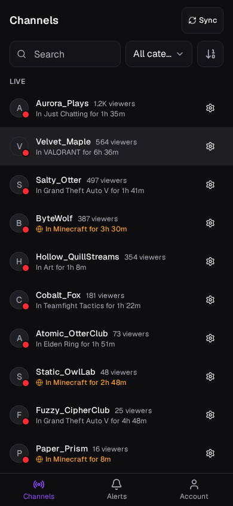
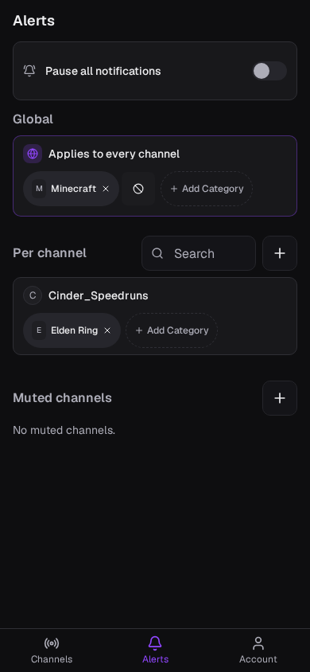
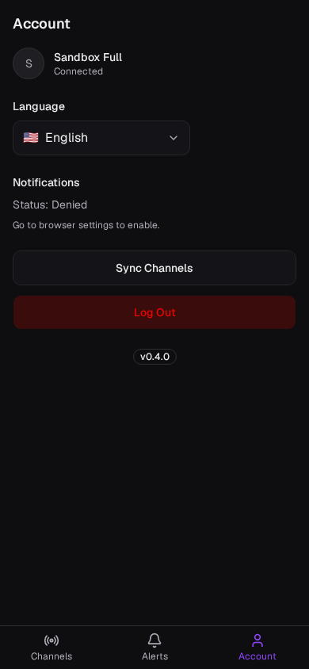

# Twitch Radar

Get a push notification the moment someone you follow on Twitch switches into a category you care about.

Mobile-first PWA for Twitch viewers who want push notifications when followed streamers start streaming selected categories. Log in with Twitch, pick the broadcasters and categories you care about, and let a Cloudflare Worker watch EventSub for you in the background — no polling, no app to keep open.

| Channels | Alerts | Account |
| --- | --- | --- |
|  |  |  |

## Features

- Sign in with Twitch; your follows sync automatically, live channels first like Twitch's sidebar.
- Category alerts per channel ("notify me when this streamer plays Minecraft") or global ("when anyone I follow plays Elden Ring"), with per-channel exclusions.
- Web Push on the installed PWA, built for iOS first, with a 15-minute snooze, pause-all, per-channel mute and a per-channel cooldown against floods.
- Runs on the Cloudflare free plan: one Worker, D1, KV and Queues, fed by Twitch EventSub webhooks.
- English, Spanish and Brazilian Portuguese.

## Quickstart

```sh
git clone https://github.com/antonbsa/twitch-radar.git
cd twitch-radar
npm install
npm run db:setup
npm run dev
```

Open `http://localhost:5173`. Signing in with a real Twitch account needs credentials in `.env.local`; the [development guide](docs/development.md) covers that, push notifications and testing from a phone.

## Documentation

- [Documentation index](docs/README.md)
- [Product](docs/product.md): what it is for, when a notification is and isn't sent, non-goals
- [Development](docs/development.md): local setup, env vars, push and mobile testing, queues and crons
- [Deployment](docs/deployment.md): Cloudflare setup, secrets, preview and production releases
- [Architecture decisions](docs/decisions/README.md) and [technical notes](docs/notes/README.md)
- [MVP architecture](specs/mvp/00.%20architecture.md) (the original plan, closed to new work)
- [Project guidance](AGENTS.md)

## Contributing

This is a solo-maintained project. Issues and pull requests are welcome! For development conventions and contribution guidance, see `AGENTS.md`.
