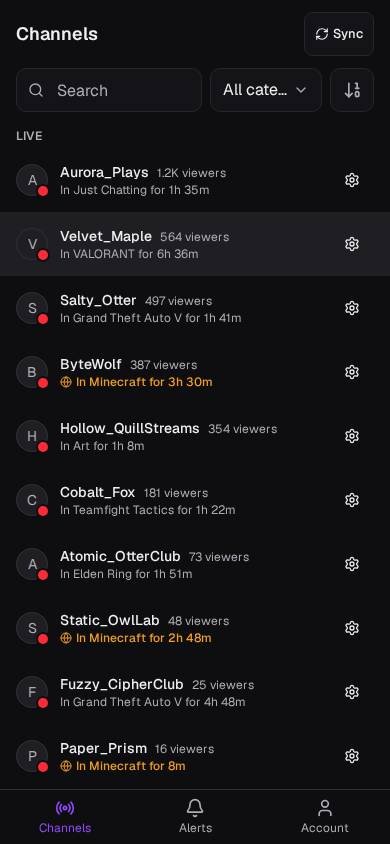
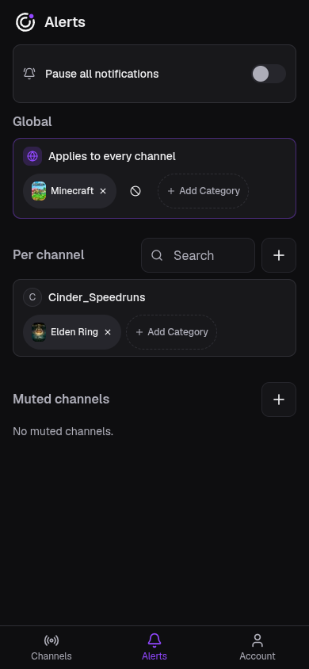
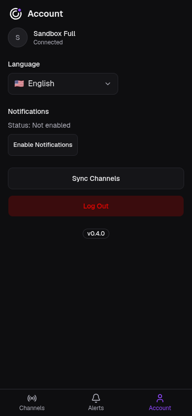

<p align="center">
  
</p>

<h1 align="center">Twitch Radar</h1>

<p align="center">Get a push notification the moment someone you follow on Twitch switches into a category you care about.</p>

Mobile-first PWA for Twitch viewers who want push notifications when followed streamers start streaming selected categories. Log in with Twitch, pick the broadcasters and categories you care about, and let a Cloudflare Worker watch EventSub for you in the background — no polling, no app to keep open.

| Channels | Alerts | Account |
| --- | --- | --- |
|  |  |  |

## Features

- Sign in with Twitch; your follows sync automatically, live channels first like Twitch's sidebar.
- Category alerts per channel ("notify me when this streamer plays Minecraft") or global ("when anyone I follow plays Elden Ring"), with per-channel exclusions.
- Web Push on the installed PWA, built for iOS first, with a 15-minute snooze, pause-all, per-channel mute and a per-channel cooldown against floods.
- Runs on the Cloudflare free plan: one Worker, D1, KV and Queues, fed by Twitch EventSub webhooks.
- English, Spanish and Brazilian Portuguese.

Try it at [twitch-radar.antonbsa.workers.dev](https://twitch-radar.antonbsa.workers.dev): open it on your phone, add it to the home screen and sign in with Twitch.

## Engineering Highlights

- Event-driven on the free plan: EventSub webhooks feed one Worker with two queues and a single cron trigger, sized to a 50-subrequest budget and a five-trigger account cap.
- Replay-safe pipeline: Twitch neither orders nor deduplicates events, so every stage is idempotent and a late retry can't produce a notification.
- iOS-first Web Push, implemented on WebCrypto with no dependency; designs that failed on a real iPhone are recorded as rejected instead of shipped half-working.
- Every decision is an ADR, three test tiers run against a real local Worker, production ships only from a published release, and coding agents work from written conventions.

The [case study](docs/case-study.md) covers the problem, the constraints, the design and its trade-offs on one page, in about ten minutes.

## Quickstart

```sh
git clone https://github.com/antonbsa/twitch-radar.git
cd twitch-radar
npm install
npm run db:setup
npm run dev
```

Open `http://localhost:5173`. Signing in with a real Twitch account needs credentials in `.env.local`; the [run locally guide](docs/guides/run-locally.md) covers that; `npm run doctor` checks your setup. [Push](docs/guides/test-push.md) and [phone](docs/guides/test-on-phone.md) testing have their own guides.

## Documentation

- [Case study](docs/case-study.md): the whole project on one page, in about ten minutes
- [Documentation index](docs/README.md)
- [Product](docs/product.md): what it is for, when a notification is and isn't sent, non-goals
- [Architecture](docs/architecture/overview.md): how it works end to end and why, one page per subsystem, plus how the project is run
- [Guides](docs/guides/run-locally.md): run locally, test push, test on a phone
- [Operations](docs/operations/incident.md): incident levers, environment setup, secrets, deploying, backup and restore
- [Architecture decisions](docs/decisions/README.md) and [technical notes](docs/notes/README.md)
- [Project history](docs/history.md): the proof of concept, the MVP and milestone 0
- [Project guidance](AGENTS.md)

## Contributing

This is a solo-maintained project. Issues and pull requests are welcome! How the project is run is described in [Engineering process](docs/architecture/engineering-process.md); conventions for coding agents live in `AGENTS.md`.
