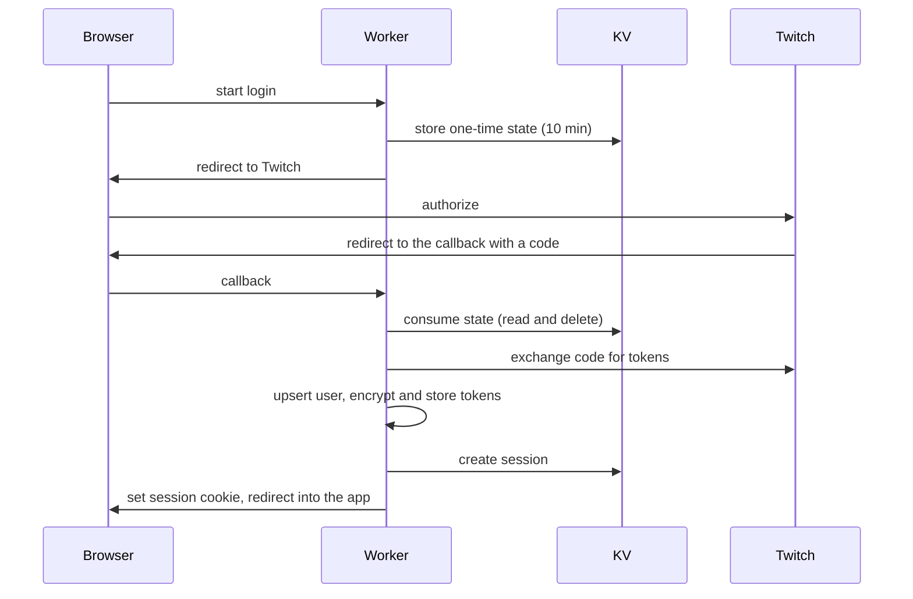

# Auth And Sessions

How a person gets into the app, how the backend keeps acting on their behalf with Twitch, and what happens when that stops working. Part of the [architecture overview](overview.md).

## Sign-In

Twitch is the only identity. The app asks for a single OAuth scope, read access to the user's follows ([ADR 0005](../decisions/0005-sync-followed-channels-with-twitch-apis.md)), because that is all it needs from the account.

The OAuth `state` is a one-time value in KV that is deleted when read, so a callback can't be replayed, and a login left open for more than ten minutes simply has to be restarted ([ADR 0017](../decisions/0017-kv-oauth-state.md)). Both the redirect URI and the post-login redirect come from the single public URL, which is why API and web must share an origin in every environment, including local development through a dev proxy and a tunnel ([ADR 0037](../decisions/0037-single-public-url-same-origin-deployment.md)). A wrong redirect URI registered at Twitch looks exactly like a broken session: the login completes and the app shows the login screen again.

## Sessions

A session is an opaque id in an `HttpOnly`, `Secure`, `SameSite=Lax` cookie, backed by a KV entry that holds the user id and expiry ([ADR 0016](../decisions/0016-kv-session-management.md)). There is no JWT, so nothing about the user leaks to the client, and logout is immediate and authoritative: deleting the KV entry ends the session.

Sessions slide. An entry lives 30 days and is renewed once it is within a week of expiring, up to a hard ceiling of 180 days from login. Renewing only near expiry costs an active user about one KV write a week instead of one per request, which matters under KV's daily write quota. The ceiling means a stolen but unused cookie can't keep itself alive forever.

Every authenticated request pays one KV read. Authorization is a middleware on the routes that need it; the webhook route is the exception and authenticates by signature instead ([monitoring](monitoring.md)).

## Twitch Tokens

The access and refresh tokens are stored in D1, encrypted with AES-256-GCM using WebCrypto ([ADR 0018](../decisions/0018-aes-gcm-token-encryption.md)). The key is derived from a secret with a single hash, so its strength is the secret's entropy, and rotating it means re-encrypting every stored token.

Tokens are kept fresh in three ways, all described in [ADR 0036](../decisions/0036-scheduled-ops-jobs.md):

- **At request time**, a call made with the user's token refreshes it when needed and retries once if Twitch answers 401. A second 401 means the grant is gone.
- **Ahead of time**, a scheduled job refreshes tokens that are about to expire, and validates them against Twitch about hourly ([scheduled jobs](scheduled-jobs.md)).
- **With a claim, not a lock.** A refresh takes an atomic per-user claim on the token row in D1, and a request that loses it re-reads the winner's result. A KV lock was tried first and rejected: KV has no atomic conditional write, and the lock burned the daily write quota.

Not every failure is the user's fault. Only a client error that isn't rate limiting (4xx other than 429) means the refresh token is dead; 429 and 5xx are Twitch being unavailable and flag nothing, so a Twitch outage never logs anyone out.

## Reconnect State

When a refresh token is dead the row is flagged, scheduled sweeps skip it, and the API reports that a reconnect is required. The app then asks the user to sign in again instead of failing silently. Any successful token write, whether a refresh or a new login, clears the flag. The state surfaces only when the client next asks for the current user: there is no push nudge for it.

## App Token

Work that has no user behind it, such as creating EventSub subscriptions or reading a stream when an event arrives, uses a Twitch app access token from the client-credentials grant. It is cached in KV until shortly before it expires ([ADR 0031](../decisions/0031-eventsub-subscription-creation-and-lifecycle.md)). Decorative lookups, such as category artwork, also use it rather than a user token, because a user token Twitch rejects would flag the session as needing a reconnect ([ADR 0058](../decisions/0058-cache-category-box-art-in-d1.md)).
