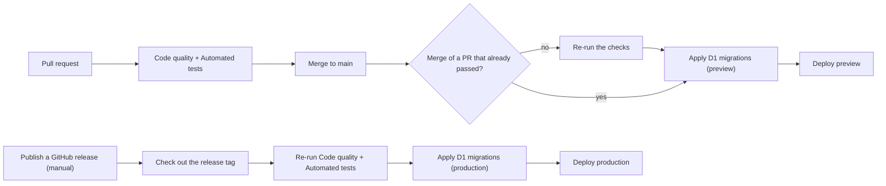

# Deploy And Release

How a change gets from a pull request to users: the environments, what CI checks, and why production only moves when a release is published. Part of the [architecture overview](overview.md). The step-by-step runbooks are in [operations](../operations/environment-setup.md) (start with the [incident page](../operations/incident.md) when something is on fire); this page is the reasoning.

## Environments

There are three: local development, a **preview** environment and **production**. Preview and production are separate Cloudflare resources (their own D1 database, KV namespace and queues, since queue names are account-global) and their own secrets, so preview exercises the real deploy path, EventSub webhooks included, without touching production data or users.

The app is a single Worker per environment on the default `workers.dev` domain. The web build is served as static assets by the same Worker, so the PWA and the API share one origin ([ADR 0037](../decisions/0037-single-public-url-same-origin-deployment.md)). One public URL per environment is the source for OAuth redirects, the post-login redirect and the webhook callback.

Development, preview and production all use the same Twitch application, so they are told apart only by their callback URL. That is why subscription reconciliation only touches subscriptions whose callback is its own ([monitoring](monitoring.md)), and why running a local server against a shared remote environment is a documented hazard: it would write local-dev values into shared data ([local development](../development.md)).

## CI

Two workflows run on every pull request, and again on pushes to `main`:

- **Code quality**: lint and formatting, typecheck, the language-catalog check, migration consistency, and the production-bundle check that test and sandbox code is absent from the production build ([ADR 0045](../decisions/0045-build-time-exclusion-of-non-production-test-code.md)).
- **Automated tests**: the API tier and the web e2e tier ([testing](testing.md)).

A newer push to the same pull request cancels the superseded run, but runs for a given commit on `main` are never cancelled. Deploys queue instead: a running deploy finishes, and only the newest pending one is kept, since only the newest build matters ([ADR 0061](../decisions/0061-concurrency-rules-for-ci-and-deploy-workflows.md)).

## Preview On Merge

Every push to `main` deploys to preview: the checks run again only if the push wasn't the merge of a pull request that already passed them, pending D1 migrations are applied to the preview database, and the Worker is deployed. Preview is the place where a merged change meets real EventSub traffic before any release.

## Production On Release

Production is deliberately decoupled from `main`. It deploys when a GitHub release is **published**: the workflow checks out the release's tag, always re-runs the whole suite against that exact commit, applies pending D1 migrations to the production database, and deploys ([ADR 0041](../decisions/0041-release-gated-production-deploys.md)). Merging to `main` alone never reaches production.

Two properties follow from that choice:

- **The git tag is the only version.** Nothing in the code reads or writes a version field. Versions are semantic with major pinned at zero until the stable release.
- **Releases are a human decision.** The release procedure drafts the version, labels and notes, but publishing, which is the production deploy, stays manual.

A migration is irreversible against production, and a new binding, cron or required variable must exist before the deploy or the Worker fails at boot. So releases name those risks explicitly. Migrations are timestamp-prefixed so concurrent branches don't collide on a number ([ADR 0059](../decisions/0059-timestamp-prefixed-d1-migrations.md)). A change to the service worker or push contract is also called out, since installed PWAs keep a cached service worker.

## Release Notes

Two audiences, no duplication ([ADR 0050](../decisions/0050-changelog-as-source-of-truth-for-release-notes.md)). A plain-language changelog, one file per supported language, is the source of truth for what users see: it is written at release time and parsed at web build time to feed the in-app "What's New" sheet. The GitHub release body is that entry followed by an engineering list that GitHub generates from pull-request labels.
