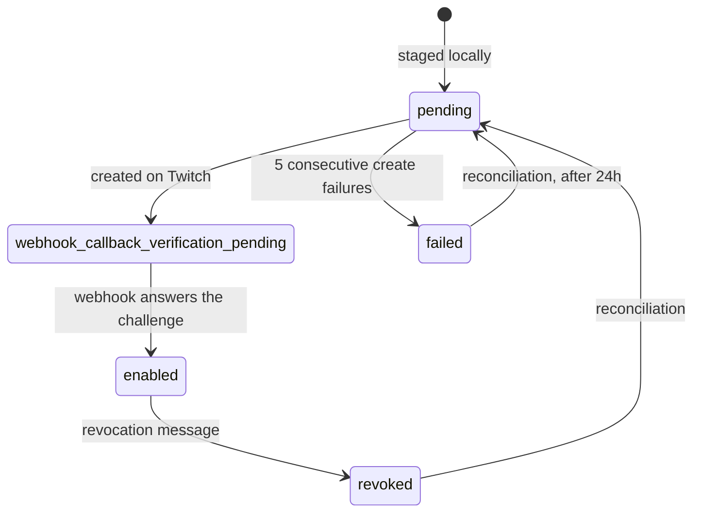

# Broadcaster Monitoring And EventSub

Which broadcasters the backend watches, how it subscribes to Twitch events for them, and how the webhook that receives those events works. Part of the [architecture overview](overview.md).

## Why Events, And Which Ones

Notifying within seconds of a category switch, for every channel anyone follows, is not something polling can do within a free plan. Twitch EventSub pushes the changes instead, over webhooks, because a serverless Worker can't hold the alternative, a WebSocket listener ([ADR 0004](../decisions/0004-use-twitch-eventsub-webhooks.md)).

Three event types are subscribed per broadcaster: a stream going online, going offline, and a channel update (title or category change). Online and update are both required, because neither alone covers every case: a stream starting in a category is an online event, and a switch while live is only an update.

## Monitored Broadcasters

Subscriptions are created **once per broadcaster, not per user**. A _monitored broadcaster_ is one that at least one active alert needs ([ADR 0007](../decisions/0007-monitor-broadcasters-globally-across-users.md)):

- a per-channel alert makes that one broadcaster monitored;
- a global alert makes every channel its owner follows monitored, and follow sync keeps that set current as follows change ([follow sync](follow-sync.md)).

Making a broadcaster monitored does three things, synchronously inside the request that caused it ([ADR 0030](../decisions/0030-monitored-broadcaster-lifecycle-and-state-seeding.md)): it records the broadcaster as monitored, seeds their current channel state if there is none (so the first event has a baseline, and so creating an alert never sends a catch-up notification for a stream that is already live, per [ADR 0008](../decisions/0008-send-category-notifications-only-for-future-matching-transitions.md)), and stages a _pending_ subscription row per event type. Nothing talks to Twitch's subscription API on the request path.

Removing the last alert that needs a broadcaster only marks them disabled. Deleting the Twitch-side subscriptions is the reconciliation job's work.

## Subscription Lifecycle

A scheduled job turns pending rows into Twitch subscriptions, using the app token, a bounded number per run ([ADR 0031](../decisions/0031-eventsub-subscription-creation-and-lifecycle.md), [scheduled jobs](scheduled-jobs.md)). So coverage is eventually consistent: a new alert covers a broadcaster after the next cron pickup plus Twitch's verification round trip, roughly a minute, and the UI never promises instant coverage.

Failures back off instead of retrying forever. Each failed create delays that row's next attempt exponentially (one minute, doubling, capped at an hour), and after five consecutive failures the row becomes terminal `failed` and stops consuming the job's budget. Reconciliation gives a failed row another chance after a day, long enough that it is there to recover from a fixed cause, such as a corrected public URL, not to repeat a permanent failure ([ADR 0049](../decisions/0049-eventsub-subscription-failure-backoff-and-callback-validation.md)). The callback URL is validated where it is derived: outside local development it must be HTTPS on a standard port, so a misconfigured environment fails loudly instead of staging rows Twitch will always reject.

## The Webhook

All events arrive at one webhook route, authenticated by its signature rather than a session ([ADR 0032](../decisions/0032-eventsub-webhook-verification-and-queueing.md)):

1. The raw body is read before any parsing, and an HMAC over message id, timestamp and body is compared in constant time with the signature header. A bad signature, missing headers or a timestamp older than ten minutes (replay guard) is rejected.
2. By message type: the verification challenge is answered with the challenge string, which also marks the subscription enabled; a revocation records Twitch's reason; a notification is put on the events queue and acknowledged with a 2xx; anything else is acknowledged and logged so Twitch doesn't retry it.

The handler does nothing else. All state changes happen in the queue consumer ([state and matching](state-and-matching.md)), which keeps the response well inside Twitch's timeout and lets the queue absorb bursts. There is no deduplication at the edge: an earlier KV-based one was removed because it wasn't reliable across edges and was the largest consumer of the daily KV write quota, while the consumer's database check already gives the hard guarantee. A duplicate delivery now costs one extra queue message.

Both queues (events, and the notification jobs described in [notification delivery](notification-delivery.md)) deliver batches of at most ten messages and flush after one second rather than waiting for a fuller batch, since a category alert is time-sensitive.

## Staying Correct Over Time

Subscriptions drift from what is needed: Twitch revokes some, a broadcaster is disabled, a webhook is missed, a database is reset. The reconciliation job compares Twitch's list, the local rows and the monitored set, and repairs the difference ([ADR 0036](../decisions/0036-scheduled-ops-jobs.md), [scheduled jobs](scheduled-jobs.md)).

Because development, preview and production share one Twitch application, a subscription is only ever touched if its callback URL is this deployment's own. That ownership guard is what makes it safe for reconciliation to delete subscriptions it doesn't recognize.
