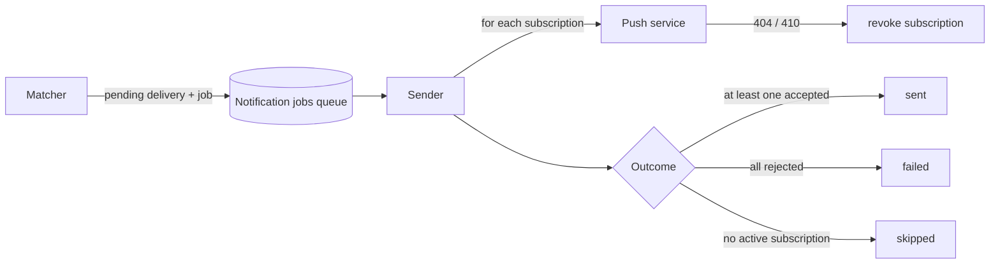

# Notification Delivery

How a decision to notify becomes a push on a device, and the controls that shape it: subscriptions, snooze, suppression and cooldown. Part of the [architecture overview](overview.md); the decision itself is made by the matcher ([state and matching](state-and-matching.md)).

## Device Registration

Receiving pushes starts on the device. In the Account tab the user grants the browser permission, and the app registers the browser's push subscription with the backend ([ADR 0027](../decisions/0027-push-subscription-lifecycle-and-api-contract.md)). The public VAPID key is served by the API rather than baked into the build, so it stays single-sourced with the private key that signs. Registration is an idempotent upsert keyed by the push endpoint, and removing a subscription is a soft revoke, because deliveries reference it.

A user can have several devices; a notification goes to all their active subscriptions.

## Two Stages, Two Queues

Staging and sending are separate so each can fail and replay on its own ([ADR 0034](../decisions/0034-notification-matching-and-delivery-pipeline.md)). The matcher writes a pending delivery and enqueues a job carrying the payload. The sender acts only on pending deliveries, so a duplicate job does nothing, and resolves the row to a terminal status. Every notification decision therefore leaves exactly one delivery row, and "did the notification go out" is one table. A user whose devices were all revoked still accrues skipped rows, which keeps the audit trail without send attempts.

A push that the push service reports as gone (404 or 410) revokes that subscription, so dead devices drop out on their own.

## The Push Itself

The Worker implements Web Push directly on WebCrypto: VAPID authorization and payload encryption, with no dependency ([ADR 0035](../decisions/0035-web-push-via-webcrypto.md)). Two properties are deliberate:

- **Expiry.** Each push asks the push service to hold it for an hour at most. An hour-old category alert is stale, and delivering it later would only confuse.
- **No automatic retries.** A late alert is worse than a missed one, and retrying after a partial multi-device success would double-notify the devices that already got it. Queue-level retries exist only for infrastructure errors, before any send outcome is recorded.

A topic is set so a repeat push for the same broadcaster replaces an undelivered earlier one at the push service. Apple's push service rejects it, so it is omitted there. Snooze reminders use their own topic so they don't replace an alert.

## What The Notification Says

The payload carries message keys and the recipient's language, not literal text ([ADR 0044](../decisions/0044-i18n-key-based-catalog-and-language-preference.md)). The service worker, which has no session to look anything up with, fetches the same language catalog the app uses and renders the text. That keeps one copy of every string, and a missing key degrades to a readable fallback rather than failing. Because language is per recipient, each user's payload is built separately.

The service worker also handles the tap, opening the app, and, where the platform supports notification actions, a snooze action ([ADR 0048](../decisions/0048-notification-snooze-reminders.md)). On installed iOS, data attached to a notification can be missing at click time, so the target is kept in a small cache the click handler falls back to. This is one of the iOS behaviors the delivery design is shaped around ([overview](overview.md)).

## Snooze

A user can ask to be reminded about a broadcaster and category again in 15 minutes, from the channel's detail view or from a notification action. It is stored separately from deliveries, because the delivery key exists to prevent exactly what a snooze asks for: telling the user again about the same stream ([ADR 0048](../decisions/0048-notification-snooze-reminders.md)).

A snooze records only the intent. When it comes due, a minutely job reads the broadcaster's _current_ state and sends a reminder only if they are still live in that category, which is the point of a reminder; otherwise it expires. The reminder goes through the same delivery pipeline with its own trigger type, so it keeps the audit trail and per-device handling. Reminders are exempt from the cooldown, since the user asked for them, but a delivered reminder starts a cooldown for later automatic alerts.

## Suppression Controls

Users can stop notifications without deleting alerts ([ADR 0054](../decisions/0054-user-controlled-notification-suppression.md)):

- **Pause all**, a state on the user rather than a list entry.
- **Mute a broadcaster**, whichever alert would match.
- **Exclude a broadcaster from one global alert**, which narrows only that alert; a per-channel alert is a more specific choice and still fires.

Pause and mute also suppress snooze reminders, so the most recent user action wins. The matcher applies all of this before staging ([state and matching](state-and-matching.md)), so suppression costs no queue work.

## Cooldown

A fixed 15-minute window per user and broadcaster, deliberately not scoped to category, trigger or stream, handles three different floods with one rule: a stream that reconnects (new stream id), a broadcaster cycling through categories, and a started-then-switched pair that reads as one event ([ADR 0056](../decisions/0056-send-side-notification-cooldown.md)). It is complementary to the display-side collapsing the service worker does with a notification tag; the two share no logic.

## What Isn't Here

No digest or batching. Merging a burst of notifications into one was implemented in the service worker and rejected after testing on an installed iOS PWA, where the list of visible notifications is empty, notifications can't be replaced by tag or closed, and an offline device loses pushes at the push service anyway ([ADR 0055](../decisions/0055-client-side-notification-digest.md), [TN 0007](../notes/0007-client-side-notification-digest-not-viable-on-ios.md)). Category artwork in pushes was also judged not worth its cost ([TN 0006](../notes/0006-category-art-in-push-notifications-not-justified.md)).
