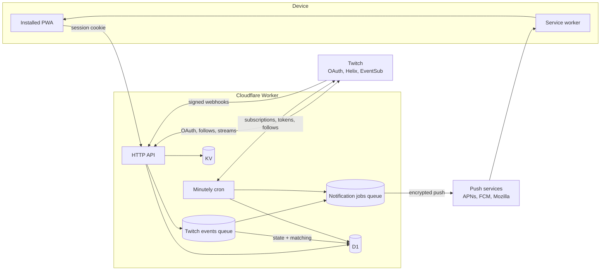
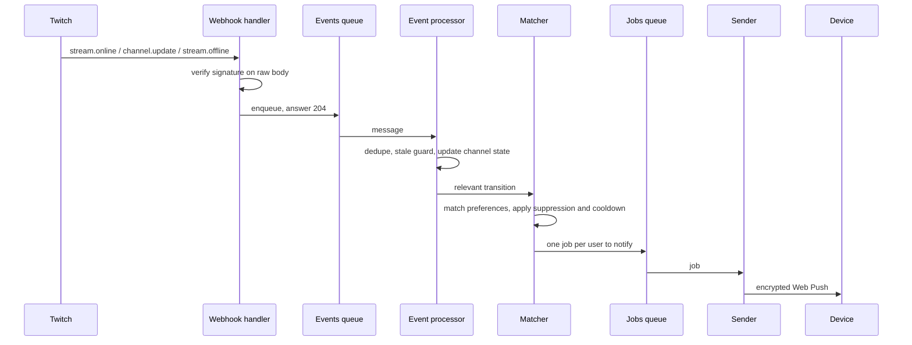
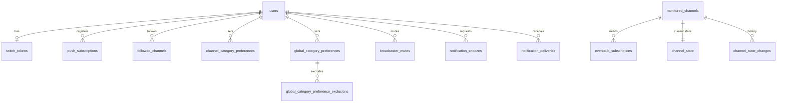

# Architecture Overview

How Twitch Radar works end to end and why it is built this way. This page is the map; each subsystem has its own page under [docs/architecture](.), and every decision links the ADR (or technical note) that records it. For what the product does see [product.md](../product.md).

The pages describe the system as it is now, by concept (the Worker, the queues, scheduled jobs), not by file. Coding conventions live in the [`AGENTS.md`](../../AGENTS.md) files, and the history of each decision in the [ADRs](../decisions/README.md).

## Constraints That Shape The Design

- **Cloudflare's free plan.** The whole backend runs on it, so the design is bounded by its limits: a small per-invocation subrequest budget (50), cron triggers capped per account (5), and daily write quotas on KV. Several choices below exist only to stay inside those numbers (a single cron trigger, no per-event KV writes, capped job batches).
- **The installed iOS PWA is the primary platform.** Web Push on an installed iOS app behaves differently from Chromium and from the specs: some notification APIs report nothing, tags don't replace earlier notifications, and an offline device loses pushes at Apple's push service. The delivery design stays on what is known to work there, and rejects what isn't ([ADR 0055](../decisions/0055-client-side-notification-digest.md), [TN 0007](../notes/0007-client-side-notification-digest-not-viable-on-ios.md)).
- **Twitch pushes events, the app never polls.** Knowing that a streamer switched category within seconds, for every followed channel of every user, is only affordable through EventSub webhooks ([ADR 0004](../decisions/0004-use-twitch-eventsub-webhooks.md)). That makes the system event-driven, and it has to cope with out-of-order and repeated deliveries.

## Stack

| Piece | Choice | Why |
| --- | --- | --- |
| Runtime | One Cloudflare Worker serving the API, the queue consumers, the cron and the PWA assets | A serverless fit for a webhook-driven workload with no always-on process ([ADR 0002](../decisions/0002-use-cloudflare-serverless-stack-for-mvp.md)), and one origin for API and web ([ADR 0037](../decisions/0037-single-public-url-same-origin-deployment.md)). |
| HTTP framework | Hono | Small, runs natively on Workers ([ADR 0014](../decisions/0014-use-hono-for-worker-api-routing.md)). |
| Durable state | D1 (SQLite) through Drizzle | Relational data with unique keys the idempotency rules lean on ([ADR 0013](../decisions/0013-use-drizzle-orm-for-d1-access.md), [ADR 0015](../decisions/0015-generate-d1-migrations-with-drizzle-kit.md)). |
| Short-lived state | KV | Sessions, OAuth state and the Twitch app token: self-expiring entries that need no sweep ([ADR 0016](../decisions/0016-kv-session-management.md), [ADR 0017](../decisions/0017-kv-oauth-state.md)). |
| Async work | Two Queues: Twitch events and notification jobs | Decouple "accept the webhook quickly" from "process it", and "decide to notify" from "send the push" ([ADR 0032](../decisions/0032-eventsub-webhook-verification-and-queueing.md), [ADR 0034](../decisions/0034-notification-matching-and-delivery-pipeline.md)). |
| Periodic work | One minutely Cron Trigger | The account-wide cap leaves no room for a trigger per job ([ADR 0057](../decisions/0057-single-minutely-cron-trigger.md)). |
| Web client | React, Vite, Tailwind, shadcn/ui, TanStack Query, React Router | A mobile-first PWA with server state in a cache ([ADR 0020](../decisions/0020-use-react-and-vite-for-web-frontend.md), [ADR 0023](../decisions/0023-use-tanstack-query-for-server-state.md)). |
| Service worker | Hand-written, no build step | It only handles push and notification clicks; no offline caching to justify a plugin ([ADR 0026](../decisions/0026-manual-service-worker-without-vite-plugin-pwa.md)). |
| Web Push | Protocol implemented on WebCrypto | The usual library depends on Node modules a Worker lacks ([ADR 0035](../decisions/0035-web-push-via-webcrypto.md)). |

## Components

The Worker is one deployable with four entry points: HTTP requests, the two queue consumers and the scheduled handler. Server code is organized by feature (auth, channels, eventsub, notifications, preferences, push), with shared services for Twitch and a thin data layer in front of D1.

## Paths Through The System

**Setting up** ([auth](auth.md), [follow sync](follow-sync.md), [monitoring](monitoring.md)). The user signs in with Twitch, the app reads their follows, and choosing an alert makes the broadcasters involved _monitored_: the backend subscribes to Twitch events for them, once per broadcaster, however many users care.

**An event arrives** ([monitoring](monitoring.md), [state and matching](state-and-matching.md), [delivery](notification-delivery.md)).

**Staying healthy** ([scheduled jobs](scheduled-jobs.md)). A minutely cron creates pending subscriptions, fires snooze reminders and refreshes Twitch tokens; every half hour it reconciles subscriptions with Twitch, and hourly it re-syncs stale follows.

## Data Model

The model separates three kinds of data:

- **Per user:** the account, the encrypted Twitch tokens, push subscriptions, follows, preferences and the controls that suppress notifications (mutes, exclusions, pause, snoozes).
- **Per broadcaster, shared by everyone:** which broadcasters are monitored, their EventSub subscriptions, their current state and the history of relevant transitions ([ADR 0006](../decisions/0006-store-current-channel-state-separately-from-history.md), [ADR 0007](../decisions/0007-monitor-broadcasters-globally-across-users.md)). Twitch is asked once per broadcaster, not once per follower.
- **Audit:** one delivery row per notification decision, with a terminal status, so "did the push go out" is a single query.

A small cache table holds category artwork ([ADR 0058](../decisions/0058-cache-category-box-art-in-d1.md)). Everything the API exposes to the web client is documented in [api-contract.md](../api-contract.md); the two sides mirror their wire types by hand instead of sharing a package ([ADR 0028](../decisions/0028-mirror-wire-shape-types-across-workspaces.md)).

## Defining Trade-offs

- **Event-driven, not polling.** EventSub webhooks give near-instant category changes at no per-poll cost, at the price of handling retries, reordering and revocations. Both `stream.online` and `channel.update` are needed, because neither alone covers every case ([ADR 0004](../decisions/0004-use-twitch-eventsub-webhooks.md)).
- **Monitor broadcasters globally.** One subscription set per broadcaster, shared by all users. A user with a global alert makes every channel they follow monitored, so subscription count grows with follows, bounded by Twitch's cost cap ([ADR 0007](../decisions/0007-monitor-broadcasters-globally-across-users.md), [TN 0003](../notes/0003-eventsub-subscription-cost-of-broadening-monitoring-scope.md)).
- **A single minutely cron trigger.** Jobs share one trigger and are picked by the scheduled minute, rather than each owning a trigger the account can't afford. They share one invocation's subrequest budget, so every job is capped per run ([ADR 0057](../decisions/0057-single-minutely-cron-trigger.md)).
- **Send-side cooldown.** At most one push per user and broadcaster every 15 minutes, decided before anything is queued, so a flapping streamer can't flood a device ([ADR 0056](../decisions/0056-send-side-notification-cooldown.md)).
- **No client-side digest.** Merging a burst into one notification in the service worker was built and rejected after trying it on an installed iOS PWA ([ADR 0055](../decisions/0055-client-side-notification-digest.md), [TN 0007](../notes/0007-client-side-notification-digest-not-viable-on-ios.md)).
- **Late is worse than missed.** Pushes are never retried automatically and expire after an hour at the push service, since an old category alert is stale and a retry could double-notify surviving devices ([ADR 0034](../decisions/0034-notification-matching-and-delivery-pipeline.md), [ADR 0035](../decisions/0035-web-push-via-webcrypto.md)).
- **Idempotency over ordering.** EventSub guarantees neither order nor uniqueness, so every stage tolerates replays instead of trying to prevent them ([ADR 0033](../decisions/0033-eventsub-state-transition-rules.md)).
- **Hand-mirrored wire types.** Two small DTO sets, edited together, are cheaper than a shared package that would blur the isolation between the Worker and the browser bundle ([ADR 0028](../decisions/0028-mirror-wire-shape-types-across-workspaces.md)).
- **Same-origin everywhere.** API and web share one public URL in every environment, so cookies, OAuth redirects and webhook callbacks derive from a single value ([ADR 0037](../decisions/0037-single-public-url-same-origin-deployment.md)).

## Where To Go Next

| Page | Covers |
| --- | --- |
| [Auth and sessions](auth.md) | Twitch OAuth, sessions, token storage and refresh |
| [Follow sync](follow-sync.md) | How follows and live state get from Twitch into the app |
| [Monitoring and EventSub](monitoring.md) | Which broadcasters are watched, subscription lifecycle, the webhook |
| [State transitions and matching](state-and-matching.md) | Turning events into channel state, and transitions into the users to notify |
| [Notification delivery](notification-delivery.md) | Push, snooze, suppression, cooldown |
| [Scheduled jobs](scheduled-jobs.md) | The minutely cron and what runs on it |
| [Observability and alerting](observability.md) | Logs, error alerting |
| [Testing strategy](testing.md) | The two test tiers, the test seam and the sandbox |
| [Deploy and release](deploy-and-release.md) | Environments, CI, preview and production |
| [Engineering process](engineering-process.md) | How the project itself is run |
