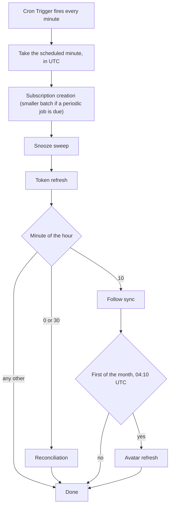

# Scheduled Jobs

What runs on a timer and why it shares one trigger. Part of the [architecture overview](overview.md).

## One Trigger

The Worker has a single Cron Trigger per environment, firing every minute. Cloudflare caps triggers per account, not per Worker, so a trigger per job left preview with one slot and made every new schedule cost a slot in each environment. Instead the handler runs the jobs that are due at the _scheduled_ minute, in UTC, and never at the wall-clock time of a late invocation ([ADR 0057](../decisions/0057-single-minutely-cron-trigger.md)).

| Cadence | Job | What it does |
| --- | --- | --- |
| Every minute | Subscription creation | Creates pending EventSub subscriptions on Twitch ([monitoring](monitoring.md)) |
| Every minute | Snooze sweep | Fires due reminders ([delivery](notification-delivery.md)) |
| Every minute | Token refresh | Refreshes tokens about to expire and validates tokens about hourly ([auth](auth.md)) |
| Minutes 0 and 30 | Reconciliation | Repairs EventSub subscriptions against Twitch and the monitored set |
| Minute 10 | Follow sync | Re-syncs follows that went stale ([follow sync](follow-sync.md)) |
| First of the month, 04:10 UTC | Avatar refresh | Refreshes stored broadcaster avatars, inside the follow sync slot |

The periodic jobs never share a minute, so an invocation runs the minutely jobs plus at most one other.

## Working Within One Invocation

Jobs run sequentially in one invocation and share its budget, in particular the free plan's cap on outgoing requests. So every job is bounded per run: subscription creation takes a smaller batch on minutes where a periodic job also runs, token refresh does a couple of refreshes and a few validations a run, follow sync handles a few users. A backlog drains over later minutes rather than breaking one invocation.

Each job catches and logs its own failure, so one failing job doesn't skip the next. A job that outgrows the shared budget should become its own queue consumer instead of reclaiming a trigger.

## Why These Jobs Exist

Event-driven systems drift. The jobs are the backstop that makes the rest self-healing ([ADR 0036](../decisions/0036-scheduled-ops-jobs.md)):

- subscriptions created lazily, after the request, so alert creation stays fast;
- reconciliation, because Twitch revokes subscriptions and local state can be reset;
- token upkeep, so a dead grant is noticed and surfaced as a reconnect state before the user hits it;
- follow re-sync, because follows change when nobody opens the app;
- the snooze sweep, because a reminder is a promise to look again later.

A skipped platform invocation drops that minute's periodic job until its next slot.

## Observability

Every job tags its logs with a stable job name, so they can be filtered by job rather than by message text, and an empty minutely pass logs at debug level so a quiet minute adds no noise in production ([ADR 0053](../decisions/0053-self-describing-scheduled-job-logs.md), [observability](observability.md)).
