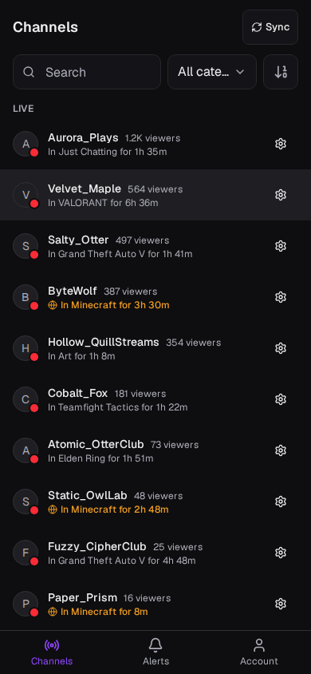
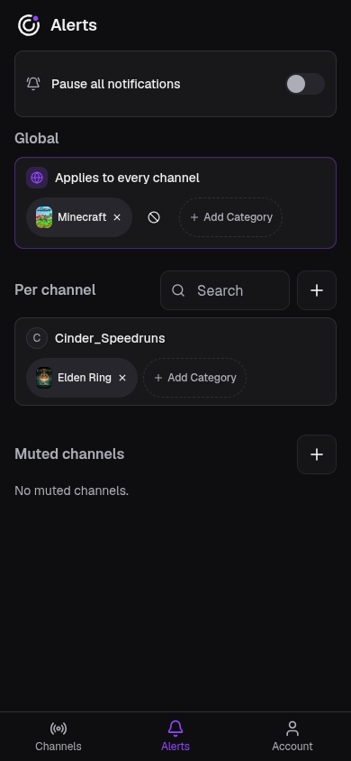
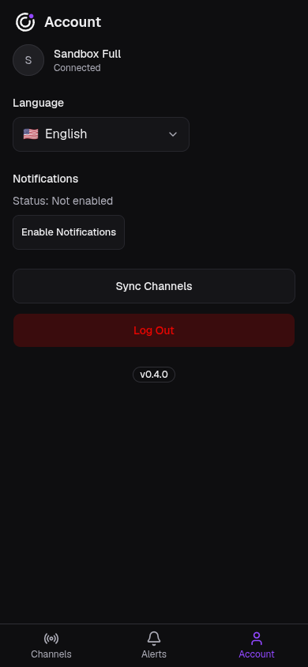
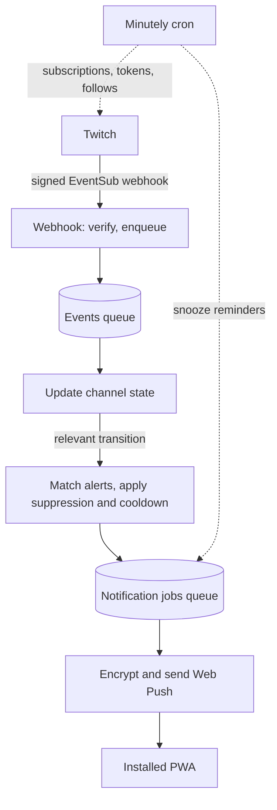

# Case Study

Twitch Radar on one page: the problem it solves, the constraints it was built under, how it works, the decisions that shaped it and what it can't do yet. It takes about ten minutes. Every section links to the page that goes deeper, and none of those is needed to follow this one ([ADR 0068](decisions/0068-one-page-case-study-as-the-short-path-through-the-docs.md)).

## At A Glance

- **What:** a mobile-first PWA that sends a push notification when a streamer you follow on Twitch goes live in, or switches into, a category you chose.
- **Built with:** one Cloudflare Worker (Hono) with D1, KV, Queues and a cron trigger on the backend; React and Vite for an installable PWA; Web Push for delivery.
- **Status:** live at [twitch-radar.antonbsa.workers.dev](https://twitch-radar.antonbsa.workers.dev), released in versions before 1.0 ([changelog](../CHANGELOG.md)), designed, built and run by one developer working with coding agents.

| Channels | Alerts | Account |
| --- | --- | --- |
|  |  |  |

## The Problem

Twitch tells you when a followed channel goes live, but not when a streamer switches to the thing you want to watch. A variety streamer who plays Minecraft on Mondays and Just Chatting the rest of the week is live all the time, so the go-live ping says nothing useful, and the choice is between muting everything and missing the stream you cared about.

Twitch Radar notifies about a **category**: "tell me when anyone I follow starts Elden Ring, or when this one streamer switches into Minecraft". A notification means one thing: a channel you follow is live right now, in a category you asked about, and that just became true. More in [product](product.md).

## Constraints

Three constraints explain most of the design ([overview](architecture/overview.md#constraints-that-shape-the-design)):

- **Cloudflare's free plan.** 50 subrequests per invocation, five cron triggers per account, a daily KV write quota. Several choices exist only to fit inside those numbers.
- **The installed iOS PWA is the primary platform.** Web Push there differs from Chromium and from the specs, so a feature isn't done until it has worked on an iPhone.
- **Twitch pushes, the app never polls.** Knowing within seconds that a streamer switched category, for every channel every user follows, is only affordable through EventSub webhooks. Those arrive out of order and sometimes twice.

## How It Works

A user signs in with Twitch, the app syncs their follows, and choosing an alert makes the broadcasters involved _monitored_: the backend subscribes to their Twitch events. When Twitch reports a stream start or a category change, the webhook verifies the signature and queues it; a consumer turns it into a state change; the matcher finds the users whose alerts match and filters out anyone who paused, muted or was just notified; a second queue sends the encrypted push. A minutely cron keeps everything else healthy: it creates pending subscriptions, refreshes tokens, re-syncs stale follows, sends snooze reminders and reconciles subscriptions with Twitch. Details in the [architecture overview](architecture/overview.md).

## Key Decisions

The decisions below each shape more than one part of the system and answer a "why not the obvious way?" a reader would ask. The [architecture overview](architecture/overview.md#defining-trade-offs) and the [decision records](decisions/README.md) have the rest.

- **Serverless on Cloudflare, with no always-on process.** The workload is webhooks, queues and short jobs, so one Worker per environment serves the API, the queue consumers, the cron and the PWA itself, all from one origin. It rules out holding a connection open, which is why events arrive as webhooks rather than over Twitch's WebSocket transport ([ADR 0002](decisions/0002-use-cloudflare-serverless-stack-for-mvp.md), [ADR 0004](decisions/0004-use-twitch-eventsub-webhooks.md), [ADR 0037](decisions/0037-single-public-url-same-origin-deployment.md)).
- **Idempotent at every stage, instead of ordered.** EventSub guarantees neither order nor uniqueness, so each stage absorbs replays: the message id guards state processing, a stale guard drops late retries, state and transition are written in one transaction, and a delivery's unique key guards staging. No crash point leads to a missed or doubled alert without another layer catching it ([state and matching](architecture/state-and-matching.md), [ADR 0033](decisions/0033-eventsub-state-transition-rules.md)).
- **Monitor broadcasters once, not once per user.** Subscriptions and channel state are shared by everyone who cares about a broadcaster, so Twitch is asked once per broadcaster. The cost: a global alert makes every channel its owner follows monitored, so subscriptions grow with follows ([monitoring](architecture/monitoring.md), [ADR 0007](decisions/0007-monitor-broadcasters-globally-across-users.md)).
- **One cron trigger for every job.** The account-wide cap leaves no room for a trigger per job, so jobs share one minutely trigger, are picked by the minute, and are each capped per run to share one subrequest budget. A backlog drains over later minutes instead of failing ([scheduled jobs](architecture/scheduled-jobs.md), [ADR 0057](decisions/0057-single-minutely-cron-trigger.md)).
- **Web Push written on WebCrypto.** The usual library needs Node modules a Worker lacks, so VAPID signing and payload encryption are implemented directly, with no dependency ([notification delivery](architecture/notification-delivery.md), [ADR 0035](decisions/0035-web-push-via-webcrypto.md)).
- **Late is worse than missed.** Pushes are never retried automatically and expire after an hour: an old category alert is stale, and a retry could double-notify the devices that already got it. A 15-minute cooldown per user and broadcaster stops a streamer who reconnects or cycles categories from flooding a phone ([ADR 0034](decisions/0034-notification-matching-and-delivery-pipeline.md), [ADR 0056](decisions/0056-send-side-notification-cooldown.md)).
- **Only future transitions notify.** Creating an alert for a stream that is already live sends nothing; the broadcaster's state is seeded when they become monitored, so only a change from then on counts ([ADR 0008](decisions/0008-send-category-notifications-only-for-future-matching-transitions.md)).
- **Wire types mirrored by hand, kept honest by contracts.** The API and the web client each declare the response shapes they share, instead of a shared package that would let server-only code leak toward the browser bundle. Every API response is a strict schema that the API tests check, and a type-level test keeps the web's copies equal to them ([ADR 0028](decisions/0028-mirror-wire-shape-types-across-workspaces.md), [ADR 0067](decisions/0067-validate-api-responses-against-zod-contracts.md)).

## What Was Hard

- **iOS behaves differently from the docs.** On an installed iOS PWA the list of shown notifications is empty, a repeated tag doesn't replace a notification, data attached to a notification can be missing when it is tapped, and an offline phone loses pushes at Apple's push service. A digest that merged bursts into one notification was built, tried on an iPhone and rejected, and the reasoning was kept so nobody tries again ([ADR 0055](decisions/0055-client-side-notification-digest.md), [TN 0007](notes/0007-client-side-notification-digest-not-viable-on-ios.md)).
- **The free plan's budgets bind in unexpected places.** Webhook deduplication in KV was the largest consumer of the daily write quota and wasn't reliable across edges, so it was removed and the database check that already gave the hard guarantee kept ([monitoring](architecture/monitoring.md#the-webhook)).
- **One Twitch application serves every environment.** Development, preview and production can see each other's subscriptions, so reconciliation only touches a subscription whose callback URL is its own; that guard is what makes deleting unknown subscriptions safe ([deploy and release](architecture/deploy-and-release.md#environments)).
- **Testing a webhook-and-queue system for real.** The API tests send real HTTP to a real local Worker, queues and cron included, with Twitch and the push services as the only fakes. What tests can't reach, push on an installed iPhone, is verified by hand through a development tunnel ([testing](architecture/testing.md)).

## How The Project Is Run

The process is as much a part of what the repository shows as the product ([engineering process](architecture/engineering-process.md)):

- **Decisions are written down.** One ADR per accepted decision, and technical notes for research that changed nothing, including designs that were tried and dropped.
- **Work starts from a spec-shaped issue** and ships as a pull request reviewed together with its tests, migrations and docs. Before the pull request, fresh subagents that see only the diff, the issue and the project rules review it ([ADR 0066](decisions/0066-isolated-pre-pr-review-by-fresh-subagents.md)).
- **Coding agents follow written conventions**: nested `AGENTS.md` files, role-scoped subagents, skills for recurring procedures, and hooks that enforce the rules agents must not break.
- **Three test tiers and static checks in CI**, plus a sandbox in development and preview where fictional personas let anyone use the app without a Twitch account. Test and sandbox code is compiled out of the production build, and a check verifies it ([ADR 0045](decisions/0045-build-time-exclusion-of-non-production-test-code.md)).
- **Merging deploys to preview; production ships only when a release is published**, after the whole suite runs again on the release tag ([deploy and release](architecture/deploy-and-release.md), [ADR 0041](decisions/0041-release-gated-production-deploys.md)).

## Limits

The design is sized for a small user base on the free plan ([scaling limits](architecture/overview.md#scaling-limits)):

- The first limit to break from outside is Twitch's cap on the total cost of EventSub subscriptions, which grows with users who authorize the app, not with follows ([TN 0003](notes/0003-eventsub-subscription-cost-of-broadening-monitoring-scope.md)).
- Subscriptions are created at a capped rate per minute, so a new global alert over a large follow list takes hours to reach full coverage.
- An offline iPhone loses pushes at Apple's push service, and nothing on this side can recover them.
- The history tables in D1 are append-only, with no pruning yet.

## Going Deeper

| Page | Covers |
| --- | --- |
| [Product](product.md) | What the app is for, when a notification is and isn't sent, non-goals |
| [Architecture overview](architecture/overview.md) | The full system map: stack, components, data model, trade-offs, scaling, security, recovery, and one page per subsystem |
| [Engineering process](architecture/engineering-process.md) | How work flows from an issue to a release, with coding agents |
| [Architecture decisions](decisions/README.md) and [technical notes](notes/README.md) | The reasoning behind each decision, and the research behind the rejections |
| [Project history](history.md) | The proof of concept, the MVP and milestone 0 |
| [Run locally](guides/run-locally.md) | Setting up a machine and running the app |
