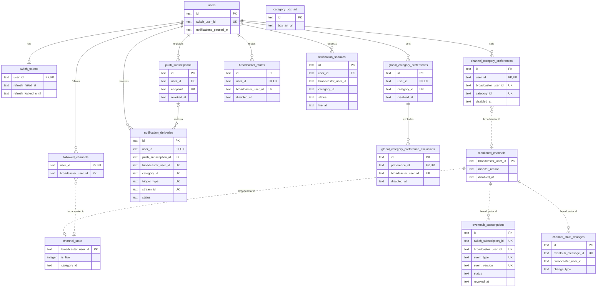

# Database

The D1 (SQLite) schema: what each table holds, how the tables relate, which unique keys the idempotency rules depend on, and the lifecycle of each status column. The [architecture overview](../architecture/overview.md#data-model) says why the data is split this way; this page is the map to read before a query or a migration. Column types, defaults and the full index list live in the Drizzle schema (`apps/api/src/db/schema.ts`), and the applied history in `infra/migrations/`; they aren't repeated here, so they can't drift from it.

## Conventions

- **Ids** are text: a type prefix plus a nanoid (`usr_`, `psub_`, `cpref_`, `gpref_`, `gprex_`, `bmute_`, `nsnz_`, `ndel_`, `esub_`, `csc_`). Per-broadcaster tables are keyed by the Twitch broadcaster id instead, and `category_box_art` by the Twitch category id.
- **Timestamps** are ISO-8601 UTC strings in `*_at` text columns. Booleans are integers (`0`/`1`).
- **Rows are soft-deleted, except EventSub subscriptions.** Preferences, exclusions, mutes and monitored channels are soft-disabled with `disabled_at`, and creating one again revives the disabled row ([ADR 0029](../decisions/0029-category-preference-api-contract-and-lifecycle.md), [ADR 0030](../decisions/0030-monitored-broadcaster-lifecycle-and-state-seeding.md)). Push subscriptions are revoked with `revoked_at`, while EventSub subscription rows are deleted by reconciliation once their broadcaster is no longer monitored.
- **Foreign keys only point at our own rows.** A column that holds a Twitch broadcaster id (`broadcaster_user_id`) has no foreign key: per-user tables reference a broadcaster that may not be monitored yet, or no longer is. The diagram draws only the main id-only links, as dotted lines.
- **Enumerations are checked in TypeScript, not by the database.** Status, reason and type columns are plain text with no `CHECK` constraint; their values are the union types in the table's repository under `apps/api/src/db/repositories/` (`eventsub_subscriptions.status` has none: it is a plain string that partly mirrors Twitch). The status and type columns are listed under [Lifecycles](#lifecycles).

## Diagram

The diagram shows each table's keys and lifecycle columns, not every column.

`UK` marks a column that is part of a unique key; several `UK` columns in one table form one composite key, listed under [Unique keys](#unique-keys).

## Tables

### Per user

| Table | One row per | Holds |
| --- | --- | --- |
| `users` | Twitch account that logged in | Twitch identity, language ([ADR 0044](../decisions/0044-i18n-key-based-catalog-and-language-preference.md)), last follow sync, and the account-wide pause ([ADR 0054](../decisions/0054-user-controlled-notification-suppression.md)). |
| `twitch_tokens` | user | The user's Twitch access and refresh tokens, AES-GCM encrypted ([ADR 0018](../decisions/0018-aes-gcm-token-encryption.md)), plus the refresh claim, the last validation and a flag for a dead refresh token ([auth](../architecture/auth.md)). |
| `push_subscriptions` | device that enabled push | The Web Push endpoint and its keys. Revoked when the push service reports it gone or the user turns push off on that device. |
| `followed_channels` | user and followed broadcaster | The follow list as of the last sync, with the broadcaster's names and avatar ([follow sync](../architecture/follow-sync.md)). |
| `channel_category_preferences` | user, broadcaster and category | "Notify me when this channel streams this category." |
| `global_category_preferences` | user and category | "Notify me when any channel I follow streams this category." |
| `global_category_preference_exclusions` | global preference and broadcaster | One broadcaster removed from one global preference. It hangs off the preference, so it survives disabling and reviving it ([ADR 0054](../decisions/0054-user-controlled-notification-suppression.md)). |
| `broadcaster_mutes` | user and broadcaster | Suppresses every notification about that broadcaster for the user, whatever matches ([ADR 0054](../decisions/0054-user-controlled-notification-suppression.md)). |
| `notification_snoozes` | reminder the user asked for | "Remind me about this stream later": fired by the minutely job at `fire_at` ([ADR 0048](../decisions/0048-notification-snooze-reminders.md)). |
| `notification_deliveries` | notification staged for sending | The audit trail: one row per staged notification with a terminal status, and the device it went to ([notification delivery](../architecture/notification-delivery.md)). |

### Per broadcaster, shared by every user

| Table | One row per | Holds |
| --- | --- | --- |
| `monitored_channels` | broadcaster someone needs alerts for | The monitored set: which broadcasters get EventSub subscriptions ([ADR 0007](../decisions/0007-monitor-broadcasters-globally-across-users.md)). `monitor_reason` is informational; whether a broadcaster is still needed is always recomputed from preferences ([ADR 0030](../decisions/0030-monitored-broadcaster-lifecycle-and-state-seeding.md)). |
| `eventsub_subscriptions` | broadcaster and event type | The local copy of each Twitch EventSub subscription (`stream.online`, `stream.offline`, `channel.update`), with the creation backoff ([ADR 0049](../decisions/0049-eventsub-subscription-failure-backoff-and-callback-validation.md)). |
| `channel_state` | broadcaster | The current Channel State: live or offline, category, title, viewers, and what the channel last streamed ([ADR 0006](../decisions/0006-store-current-channel-state-separately-from-history.md)). |
| `channel_state_changes` | State Change | Append-only history of relevant transitions, one per EventSub message ([state and matching](../architecture/state-and-matching.md)). |

### Cache

| Table | One row per | Holds |
| --- | --- | --- |
| `category_box_art` | Twitch category | The box art URL template, filled lazily on read. A null URL is a cached "Twitch has no art", not a missing row ([ADR 0058](../decisions/0058-cache-category-box-art-in-d1.md)). |

Sessions, OAuth state and the Twitch app token live in KV, not D1 ([architecture overview](../architecture/overview.md)).

## Unique Keys

The idempotency rules lean on these keys: a write that would duplicate one reuses or ignores the existing row, so a retried request, a replayed EventSub message or a duplicate queue job changes nothing.

| Table | Unique key | Guarantees |
| --- | --- | --- |
| `users` | `twitch_user_id` | One account per Twitch user; logging in again updates it. |
| `push_subscriptions` | `endpoint` | Re-enabling push on a device reuses its row. |
| `followed_channels` | `user_id, broadcaster_user_id` (primary key) | A sync upserts follows instead of duplicating them. |
| `channel_category_preferences` | `user_id, broadcaster_user_id, category_id` | Creating an existing preference revives it. |
| `global_category_preferences` | `user_id, category_id` | Same, for global preferences. |
| `global_category_preference_exclusions` | `preference_id, broadcaster_user_id` | One exclusion per broadcaster per preference. |
| `broadcaster_mutes` | `user_id, broadcaster_user_id` | One mute per broadcaster per user. |
| `eventsub_subscriptions` | `broadcaster_user_id, event_type, event_version` | Ensuring monitoring twice doesn't create a second Twitch subscription. |
| `eventsub_subscriptions` | `twitch_subscription_id` | A revocation or reconciliation finds the one local row for Twitch's id. |
| `channel_state_changes` | `eventsub_message_id` | A redelivered EventSub message records no second State Change. |
| `notification_deliveries` | `user_id, broadcaster_user_id, category_id, trigger_type, stream_id`, except snooze reminders | At most one notification per user, broadcaster, category and trigger in one stream. Reminders repeat within a stream, so the key is partial ([ADR 0048](../decisions/0048-notification-snooze-reminders.md)). |

## Lifecycles

| Column | Values | Transitions |
| --- | --- | --- |
| `notification_deliveries.status` | `pending`, `sent`, `failed`, `skipped` | The matcher writes `pending`; the sender resolves it to one terminal status and never retries a decided row ([ADR 0034](../decisions/0034-notification-matching-and-delivery-pipeline.md)). `skipped` means the user had no active device. Mutes, the pause and the send-side cooldown act before staging, so they leave no row ([ADR 0056](../decisions/0056-send-side-notification-cooldown.md)). |
| `notification_deliveries.trigger_type` | `stream_started_in_category`, `switched_into_category`, `snooze_reminder` | Set once, from the State Change or reminder that caused the notification. |
| `notification_snoozes.status` | `pending`, `fired`, `expired` | `pending` until the minutely job reaches `fire_at`; then `fired` if the channel is still live in that category, else `expired`. It also expires when the user has paused notifications or muted the broadcaster ([ADR 0048](../decisions/0048-notification-snooze-reminders.md), [ADR 0054](../decisions/0054-user-controlled-notification-suppression.md)). |
| `eventsub_subscriptions.status` | `pending`, `failed`, then Twitch's own statuses (`webhook_callback_verification_pending`, `enabled`, revocation reasons) | Monitoring writes `pending`; the minutely job creates it on Twitch with backoff and marks it `failed` when it runs out of attempts; after that the column mirrors Twitch, and a revocation also sets `revoked_at`. Reconciliation resets a `failed` row to `pending` once a 24h cooldown has passed, and any row whose Twitch subscription is missing or unhealthy, clearing `revoked_at`, `twitch_subscription_id`, `failure_count` and `next_retry_at` ([ADR 0049](../decisions/0049-eventsub-subscription-failure-backoff-and-callback-validation.md), [monitoring](../architecture/monitoring.md)). |
| `channel_state_changes.change_type` | `stream_started`, `stream_ended`, `category_changed` | Append-only; rows are never updated. |
| `monitored_channels.monitor_reason` | `channel_preference`, `global_preference` | Last writer wins; informational only. |
| `disabled_at` (preferences, exclusions, mutes, monitored channels) | null or a timestamp | Null is active. Delete sets it; create clears it on the existing row. For a disabled monitored channel, reconciliation deletes its Twitch subscriptions and their local rows. |
| `revoked_at` (push and EventSub subscriptions) | null or a timestamp | Push: set when the push service reports the endpoint gone (404/410 or undecodable keys) or the user turns push off on that device; a revoked push subscription is no longer a send target. EventSub: set when Twitch revokes the subscription, and cleared when reconciliation resets the row to `pending`. |

## Changing the Schema

Edit `apps/api/src/db/schema.ts`, then generate the migration with `npm run migrations:create`; migrations are never hand-written, and a change that alters existing data backfills it in the same migration ([infra AGENTS.md](../../infra/AGENTS.md), [ADR 0015](../decisions/0015-generate-d1-migrations-with-drizzle-kit.md)). Update this page in the same change when a table, a relation, a unique key or a status value changes.
